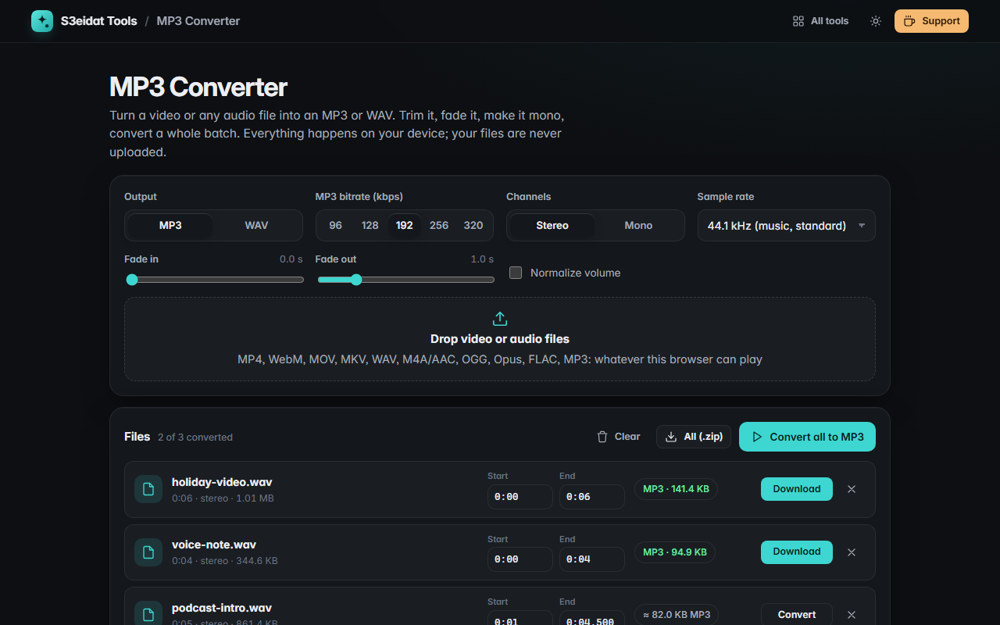

# MP3 Converter

> Turn video or audio files into MP3 (or WAV). Free, private, and it runs entirely in your browser.

### ▶ [Open MP3 Converter](https://s3eidat.github.io/mp3-converter/)



## Features

- **Video to MP3**: pull the sound out of MP4, WebM, MOV or MKV videos
- **Audio to MP3**: WAV, M4A/AAC, OGG, Opus, FLAC, MP3 and anything else your browser can play
- **Bitrate** 96, 128, 192, 256 or 320 kbps; **stereo or mono**; sample rate 16 to 48 kHz
- **WAV export** (16-bit PCM) as an alternative output
- **Trim** each file with start and end times, **fade in / fade out**, optional **normalize** to −1 dB
- **Batch**: drop many files, convert all, download each or **all as a zip**
- Estimated output size before you convert, progress while encoding, Stop button
- A clear message when a file's audio codec can't be decoded by this browser, or a video has no sound

Notes: below 32 kHz MP3 (MPEG-2) allows at most 160 kbps, so higher choices are capped there.
Files are decoded fully into memory, so very long recordings (hours) need a lot of RAM.

## Privacy

Your files never leave your device: audio is decoded by your browser's own WebAudio decoder and encoded in this tab.
There is no server, no account, no analytics. The page ships with a strict Content-Security-Policy (`connect-src 'self'`),
so the browser itself blocks any attempt to send data anywhere. Only your settings are remembered in this browser.

## Run it yourself

It's plain HTML, CSS and JavaScript with no build step:

```bash
git clone https://github.com/s3eidat/mp3-converter
cd mp3-converter
python -m http.server 8000
```

Then open http://localhost:8000.

## Credits

MP3 encoding by [lamejs](https://github.com/zhuker/lamejs), a JavaScript port of the [LAME](https://lame.sourceforge.io/)
MP3 encoder, licensed under the **LGPL**. It is shipped **unmodified** as a separate file, `lib/lame.min.js`, with its notice in
`lib/lame.LICENSE`; you can replace that file with your own build of lamejs.

## Support

If this saved you time, **[buy me a coffee ☕](https://s3eidat.github.io/coffee/)**. It keeps every tool free.

---

Part of **[S3eidat Tools](https://s3eidat.github.io/)**: 100+ free, private tools that run in your browser. MIT licensed.
